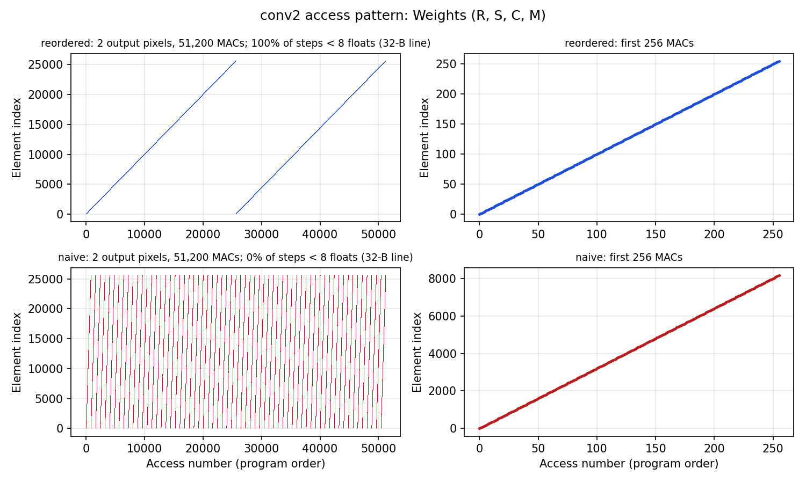
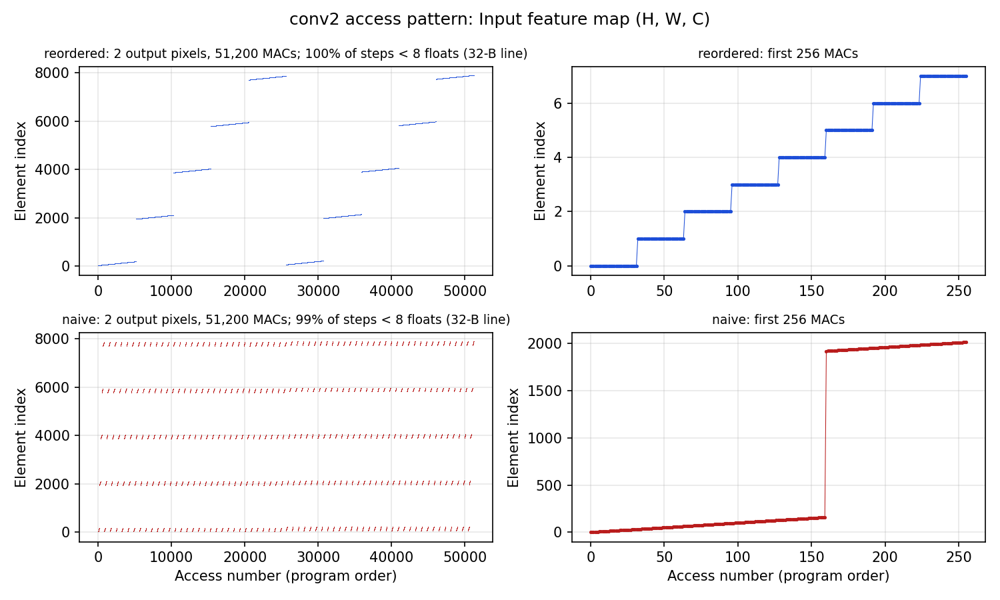
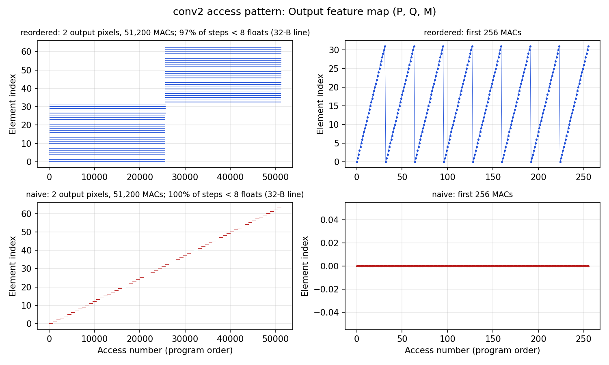
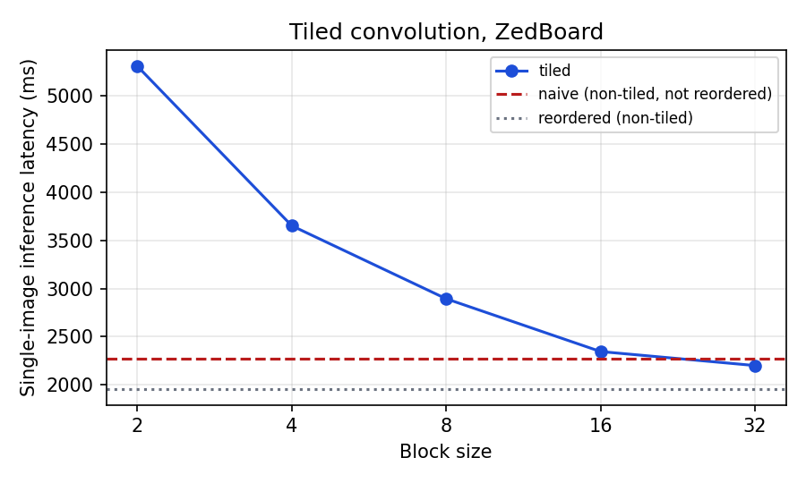
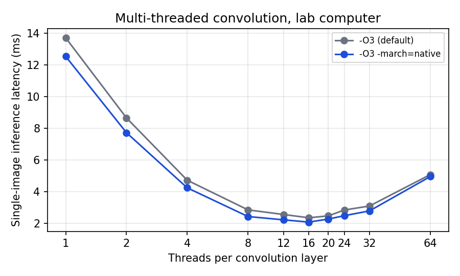
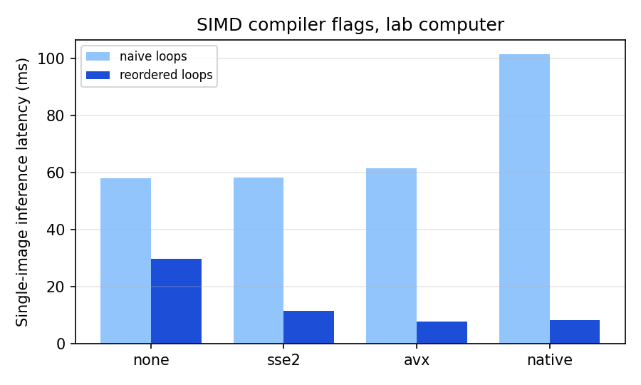

# CprE 487/587 Lab 6 — Multithreading, Tiling, and SIMD

Iowa State University · CprE 487/587 · Lab 6 · Team 06

The Lab 2 C++ inference framework ([devjwk/cpre487lab2](https://github.com/devjwk/cpre487lab2), commit `38761dd`), made faster on CPUs: a cache-friendly loop order, cache tiling, threads, and SIMD compiler flags. Every variant is checked against the naive loops layer by layer and against the TensorFlow output of every timed inference. The handout is [`CprE487_587_Lab6.pdf`](CprE487_587_Lab6.pdf); the sections below follow its highlighted items.

> **Status (2026-10-14).** Code, scripts and the access-pattern charts are done and checked on a Mac (Apple M3, clang). The measurements the handout asks for have to come from the lab computer (x86, g++) and the ZedBoard. Lab computer results are in (co2050-18, 2026-11-03); places still waiting for ZedBoard numbers are marked <!-- TEMPLATE --> **TODO(lab)**.

## What changed from Lab 2

| File | Change |
|---|---|
| `src/layers/Convolutional.cpp` | `computeNaive` is kept as the "before" version. New `computeReordered` (loop order p, q, r, s, c, m), `computeTiled` (blocks of `TILE_SIZE` output and input channels), `computeThreaded` (output pixels split over `NUM_THREADS` `std::thread`s), `computeSIMD` = reordered loops (the SIMD comes from compiler flags) |
| `src/layers/Dense.h` | `computeReordered`: weights read in storage order instead of with a stride of M |
| `src/layers/Layer.h`, `src/Model.cpp` | New `InfType::REORDERED`; layers without one use their naive loops |
| `src/ML.cpp` | `ml check`, `ml bench`, `ml throughput` (below); on the ZedBoard `main` runs the whole §3.1 sweep |
| `Makefile` | `SIMD=none\|sse2\|avx\|avx512\|native`, `ASM=true` (keeps `Convolutional.s` next to the object), `BDIR=` for one build folder per setting |
| `scripts/create_vitis`, `common_args.tcl` | `-simd yes` (NEON), `-asm yes` (`-save-temps=obj`), `-zed_iters N` |
| `scripts/run_lab6_x86.sh` | All x86 measurements in one run → `results/x86/` |
| `scripts/plot_lab6.py`, `scripts/plot_access_patterns.py` | Report tables, charts and assembly summaries → `results/plots/` |

`computeReordered` and `computeThreaded` add the products in the same order as the naive loops, so their outputs are bit-identical to it (`ml check` prints `layer_max_diff=0`). Tiling splits the sum over input channels into blocks, so it differs by rounding only (≤ 7e-6).

## Build and run

```bash
make                                   # same flags as Lab 2 (-O3)
./build/ml                             # Lab 2 layer-by-layer tests
./build/ml check                       # every variant vs. naive, layer by layer (several block / thread counts)
./build/ml bench <naive|reordered|tiled|threaded|simd> [iters=100] [block=16] [threads=8]
./build/ml throughput <mode> [iters=300] [workers=8] [conv_threads=1]
make BDIR=build_avx SIMD=avx ASM=true  # one build folder per SIMD setting
```

`bench` prints one line per run, e.g. `BENCH mode=reordered block=16 threads=8 iters=100 mean_ms=... min_ms=... conv2_ms=... pass=100/100`, then `LAYERS_MS` with the mean time of each of the 13 layers. `pass` counts inferences whose output matches TensorFlow within 0.001.

### Lab computer

```bash
./scripts/run_lab6_x86.sh 100          # ~5 min; results/x86/{cpu,check,tiling,threads,simd,throughput}.txt
python3 scripts/plot_lab6.py           # tables + results/plots/*.png + assembly snippets
```

### ZedBoard

The SD card needs the same `data/` as Lab 2 (`./scripts/upload_data` if it is not there). One run does the check plus 100 inferences each of naive, reordered and tiled with block 2, 4, 8, 16, 32 (about 15–20 minutes; `-zed_iters 5` for a quick try).

```bash
mkdir -p results/zedboard
./scripts/create_vitis -xsa_path scripts/test_hardware.xsa -workspace_dir workspace/vfp -asm yes
./scripts/flash_vitis -workspace_dir workspace/vfp | tee results/zedboard/sweep.txt        # Ctrl-C after "COMPLETE"
cp workspace/vfp/mlp/Debug/src/framework/layers/Convolutional.s results/zedboard/asm_vfp.s

./scripts/create_vitis -xsa_path scripts/test_hardware.xsa -workspace_dir workspace/neon -asm yes -simd yes
./scripts/flash_vitis -workspace_dir workspace/neon | tee results/zedboard/sweep_neon.txt
cp workspace/neon/mlp/Debug/src/framework/layers/Convolutional.s results/zedboard/asm_neon.s
```

## 3.1 Tiling

### 3.1.1 Cache sizes of the ZedBoard

The ZedBoard's Zynq-7020 has two ARM Cortex-A9 cores at 667 MHz (Zynq-7000 TRM, UG585, ch. 3).

| Cache | Size | Organization |
|---|---|---|
| L1 instruction | 32 KB per core | 4-way, 32-byte lines |
| L1 data | 32 KB per core | 4-way, 32-byte lines |
| L2 (unified, shared by both cores) | 512 KB | 8-way, 32-byte lines (PL310 controller) |
| L3 | none | the 256 KB on-chip memory (OCM) is addressable RAM, not a cache |

For comparison, conv2 has 100 KB of weights (5·5·32·32 floats = 102,400 B), a 450 KB input and a 392 KB output: the weights do not fit in L1, and the input and output together do not fit in L2.

### 3.1.2 Memory access pattern and reordering

conv2 (layer 1) takes about 60% of the inference time on both machines in Lab 2 (1,356 of 2,272 ms on the ZedBoard) and holds 80.3 M of the model's 131.6 M MACs, so it is the layer to optimize.

**Naive order (p, q, m, r, s, c), the "before" version.** The innermost loop runs over c. Input reads `in[(p+r, q+s, c)]` are unit-stride, but weight reads `w[(r, s, c, m)]` jump by M = 32 floats = 128 bytes: consecutive weight reads land on different 32-byte cache lines, using 4 bytes of each. One output pixel reads every weight once, but a line's 8 floats (8 values of m) are read 800 accesses apart, after the loop has swept the other 100 KB of weights through a 32 KB L1, so on the ZedBoard nearly every weight read misses L1.

**Reordered (p, q, r, s, c, m), `computeReordered`.** The weight file is already stored as (R, S, C, M) with M last, so no re-export is needed: moving m to the innermost loop makes all three streams unit-stride.

- Weights: one output pixel reads the 25,600 weights exactly once, in storage order (spatial reuse: all 8 floats of each line are used).
- Input: one value `in[p+r, q+s, c]` is loaded once and kept in a register for 32 MACs (temporal reuse).
- Output: the 32 partial sums of the pixel (128 bytes = 4 lines) are updated in place and stay in L1 for the whole pixel (temporal reuse).

An extra benefit is that the inner loop is now an element-wise `o[m] += x * w[m]` with independent iterations, which the compiler can vectorize (§3.3); the naive loop is a reduction into one `sum`, which GCC does not vectorize without `-ffast-math`.

`scripts/plot_access_patterns.py` plots the element index of every access for the first two output pixels of conv2, in program order (top: reordered, bottom: naive):

| Weights | Input feature map | Output feature map |
|---|---|---|
|  |  |  |

How the charts show the reuse: the reordered weight trace is one straight line of slope 1 per pixel (every byte of every line used, prefetcher-friendly), while the naive trace is 32 sawtooth sweeps of stride 32. The reordered input trace is a staircase: each step is one value held for 32 MACs. The reordered output trace stays inside a 32-element window (one pixel's 128 bytes) for 25,600 MACs. In the reordered loops 100% of weight and input steps and 97% of output steps move less than one cache line (32 bytes = 8 floats); for the naive weights it is 0%.

**Speedup** (mean of 100 inferences, cycling through the 3 test images):

| Machine | Naive (ms) | Reordered (ms) | Speedup | conv2 naive → reordered (ms) |
|---|---|---|---|---|
| ZedBoard | **TODO(lab)** | **TODO(lab)** | | |
| Lab computer (co2050-18, i7-12700) | 58.23 | 9.55 | 6.1× | 33.77 → 6.11 |
| *Mac M3 (dev check only)* | *101.5* | *13.1* | *7.7×* | *65.3 → 8.9* |

### 3.1.3 Tiling

`computeTiled` splits the output channels m and input channels c into blocks of B (`TILE_SIZE`). For one (m block, c block) pair it sweeps every output pixel, so the weights it touches, R·S·B·B floats, are reused 3,136 times while they stay in cache. For conv2 that is 25 · B² · 4 bytes: 400 B (B=2), 1,600 B (4), 6,400 B (8), 25,600 B (16, still inside the 32 KB L1), 102,400 B (32 = no tiling, the reordered loops plus one extra pass). The price is that each output pixel's partial sums are reloaded (C/B times) and the inner loop gets shorter as B shrinks.

| Version | Block | ZedBoard (ms) | Speedup vs naive | Speedup vs reordered |
|---|---|---|---|---|
| Naive | — | **TODO(lab)** | 1.00 | |
| Reordered (non-tiled) | — | | | 1.00 |
| Tiled | 2 | | | |
| Tiled | 4 | | | |
| Tiled | 8 | | | |
| Tiled | 16 | | | |
| Tiled | 32 | | | |



**Optimal block size:** **TODO(lab)**. What to look for: B=2 and 4 run a 2–4 iteration inner loop with the loop overhead and partial-sum reloads dominating; B=16 is the largest block whose weight tile (25,600 B) fits in the 32 KB L1 data cache next to the input and output lines; B=32 no longer fits and falls back to L2. On the Mac (128 KB L1, dev check) no block size beat the reordered loops, because conv2's 100 KB of weights already fit in L1 there.

On the lab computer (default -O3) tiling also never beats the reordered loops: 106.9 / 49.2 / 32.8 / 21.2 / 13.9 ms for B = 2 / 4 / 8 / 16 / 32, against 9.55 ms reordered and 58.2 ms naive. The i7-12700's 1.25 MB L2 per P-core holds all of conv2's weights, so blocking saves no misses there and only adds the shorter inner loops and the C/B reloads of the partial sums; latency falls monotonically as B grows (`results/plots/tiling_x86.png`).

## 3.2 Multi-threading (lab computer only)

`computeThreaded` splits the P·Q output pixels of each convolution into `NUM_THREADS` equal ranges and runs `convPixels` (the reordered loops) on each with `std::thread`. Threads write disjoint outputs and only read shared data, so no locks are needed. Splitting pixels instead of rows lets 64 threads still get work in conv6 (8×8 = 64 pixels). The threads are created and joined inside every conv layer call, so their start-up cost is part of the measured latency.

| Threads | -O3 (ms) | Speedup | -O3 -march=native (ms) | Speedup vs 1 thread -O3 |
|---|---|---|---|---|
| 1 | 13.70 | 1.00 | 12.53 | 1.09 |
| 2 | 8.64 | 1.58 | 7.71 | 1.78 |
| 4 | 4.71 | 2.91 | 4.23 | 3.24 |
| 8 | 2.84 | 4.83 | 2.42 | 5.67 |
| 12 | 2.54 | 5.39 | 2.21 | 6.21 |
| **16** | **2.34** | **5.86** | **2.06** | **6.64** |
| 20 | 2.46 | 5.58 | 2.25 | 6.08 |
| 24 | 2.83 | 4.85 | 2.47 | 5.55 |
| 32 | 3.08 | 4.45 | 2.77 | 4.94 |
| 64 | 5.06 | 2.71 | 4.94 | 2.77 |

Mean of 100 inferences each; every output matched TensorFlow (100/100).



**Optimal number of threads: 16** (2.06 ms with `-march=native`, 6.6× over one thread at -O3). Latency drops almost linearly up to 8 threads (one per P-core), gains little from 8 to 16, and rises after 20. Hardware (`results/x86/cpu.txt`): the lab computer co2050-18 has an Intel i7-12700 with 8 performance cores (2 hardware threads each) and 4 efficiency cores, 20 hardware threads in all. The work per call is small (conv2 is ~80 M MACs, a few ms single-threaded), so past the number of physical cores extra threads add creation and scheduling cost without adding execution units; hyper-threads share a core's vector units, and an even split leaves the threads on slower E-cores as the stragglers. conv2 alone keeps speeding up to 32 threads (0.73 ms), but the small late layers (conv5: 100 pixels, conv6: 64) cannot use that many threads, and every conv layer pays to create and join them, so the whole inference is fastest at 16. At 64 threads creating and joining them costs about 0.5 ms per conv layer call (4.94 − 2.06 ms spread over 6 conv layers), more than the work it splits.

## 3.3 SIMD

Flags (all with -O3, `DEBUG=false` equivalent; `make SIMD=<x>`):

| Setting | Flags | Meaning on x86-64 |
|---|---|---|
| No SIMD | `-fno-tree-vectorize -fno-tree-slp-vectorize` | auto-vectorization off; scalar SSE only (`mulss`, `addss`) |
| SSE2 | `-msse2` | 128-bit, 4 floats; identical to the default, since SSE2 is part of x86-64 |
| AVX | `-mavx` | 256-bit, 8 floats |
| AVX-512 (optional) | `-mavx512f` | 512-bit, 16 floats; the i7-12700 (Alder Lake) does not run AVX-512, so the script skips it there |
| All | `-march=native` | everything the CPU has: AVX2 and FMA on the i7-12700 |

| Setting | Naive loops (ms) | Reordered loops (ms) | Speedup vs No SIMD |
|---|---|---|---|
| No SIMD | 58.00 | 29.69 | 1.00 |
| SSE2 (= default) | 58.24 | 11.41 | 2.60 (reordered) |
| AVX | 61.58 | **7.72** | **3.84** (reordered) |
| -march=native (AVX2 + FMA) | 101.52 | 8.25 | 3.60 (reordered) |

Single-threaded, mean of 100 inferences, all 100/100 correct. The flags only help the reordered loops, whose inner `o[m] += x * w[m]` vectorizes: 4 lanes (SSE2) give 2.6×, 8 lanes (AVX) 3.8×. The naive loops are a reduction into one sum over strided weights and stay scalar; with `-march=native` they get *slower* (58 → 102 ms), which the assembly has to explain (likely the compiler gathering the stride-32 weights with AVX2 `vgatherdps`). **TODO(lab): confirm from `asm_native.s`.**

Run-to-run noise: the same `build_sse2` reordered binary measured 9.55 ms (tiling run), 11.41 ms (SIMD run) and 13.70 ms (1 thread in the thread run). On this hybrid CPU a single-threaded process may land on a P-core or an E-core, and turbo clocks vary, so single-thread comparisons are only good to roughly ±20%.



**Assembly.** `python3 scripts/plot_lab6.py` counts the floating-point instructions in each `build_<simd>/layers/Convolutional.s` and prints the inner loop around the widest one. Expected (checked with clang on the Mac by cross-compiling for x86-64; the report must use the lab computer's g++ output): No SIMD has only scalar `mulss`/`addss`; SSE2's inner loop of the reordered kernel becomes `movups` + `mulps` + `addps` on `%xmm` (4 floats per instruction); AVX uses `vmulps`/`vaddps` on `%ymm` (8 floats); `-march=native` adds AVX2/FMA, but GCC in ISO mode (`-std=c++11`) keeps `-ffp-contract=off`, so expect separate `vmulps`/`vaddps` on `%ymm` rather than `vfmadd231ps` (clang did fuse them for AVX-512). The naive loop's single-accumulator reduction stays scalar in every setting, which is why the flags barely change the naive time. Lane counts give the ideal speedups (4×, 8×); memory bandwidth and the scalar code outside conv inner loops keep the measured ones lower.

**Snippets: TODO(lab)** (paste from the `plot_lab6.py` output for each configuration).

### ZedBoard SIMD (NEON)

The Cortex-A9 has a NEON unit (128-bit, 4 floats). Vitis compiles for the scalar VFPv3 FPU by default; `create_vitis -simd yes` adds `-mfpu=neon -funsafe-math-optimizations` (GCC only uses NEON for float math with the second flag, because NEON flushes denormals to zero and is not IEEE-exact).

| Version | VFP (ms) | NEON (ms) | Speedup |
|---|---|---|---|
| **TODO(lab)** | | | |

Assembly to compare (`results/zedboard/asm_{vfp,neon}.s`): VFP uses `vmul.f32`/`vadd.f32` (or `vmla.f32`) on single registers `s0`–`s31`; NEON uses the same mnemonics on quad registers `q0`–`q15` (4 floats).

## 3.4 Need for Speed

The best single-image latency combines the reordered loops, `-march=native`, and the best thread count; the best throughput runs one model per worker thread with single-threaded reordered layers (no per-layer thread start-up, and every core busy).

| | Lab computer | TensorBoard (Lab 1) |
|---|---|---|
| Best latency | **2.06 ms** (reordered, `-march=native`, 16 threads, 100 images) | 56.3 ms per online `model.predict` call; 1.78 ms of it is the layers' own ops |
| Best throughput (≥100 images) | **1,141 img/s** (32 workers, one model each, 1,000 images) | 842 img/s at batch 200 (1.19 ms per image) |

Lab 1's TensorBoard profile measured 0.58 ms of operator time per image at batch 200 (the fastest recorded).

- **Latency:** 2.06 ms is 27× faster than TensorFlow's online `model.predict` call (56.3 ms, mostly Python and framework overhead) and close to the 1.78 ms TensorFlow's kernels themselves need for one image.
- **Throughput:** 1,141 img/s beats TensorFlow's best batched throughput (842 img/s), but the time per image, 0.88 ms (1,000 / 1,141 img/s), is still above TensorFlow's 0.58 ms of operator time at batch 200: its oneDNN kernels use blocked layouts, FMA and register tiling across images that a plain loop nest does not.
- Throughput scales almost linearly to 8 workers (879 img/s, one per P-core), then slowly to 1,124 img/s at 20 (all hardware threads) and 1,141 at 32.

## Not done

- Quantization for the optimized versions (optional in the handout).
- Above & Beyond items (GPU/SIMT, intrinsics, OpenMP).
- Report PDF and code archive (`lab6_report_06.pdf`, `lab6_code_06.zip`).
